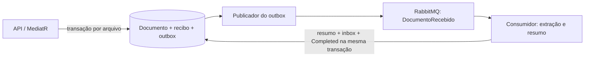

# Fiscal Documents API

API do desafio técnico em .NET 10, Clean Architecture, DDD e CQRS com MediatR. SQL Server garante unicidade e concorrência; RabbitMQ transporta eventos com entrega *at least once*. Outbox e inbox tornam os efeitos de negócio idempotentes.

## Executar no Windows, sem Docker

Instale previamente:

- **SDK .NET 10** (o SDK, não somente o runtime).
- **SQL Server Express LocalDB**, pela opção LocalDB do Visual Studio Installer ou pelo [instalador SQL Server Express](https://learn.microsoft.com/en-us/sql/database-engine/configure-windows/sql-server-express-localdb). Também é possível usar SQL Server/Express já instalado com uma conexão explícita.
- **RabbitMQ 4.x com uma versão compatível de Erlang**, seguindo o [guia oficial para Windows](https://www.rabbitmq.com/docs/install-windows). Confirme que o serviço RabbitMQ está em execução. O plugin de administração é opcional para a aplicação.

Os scripts são compatíveis com Windows PowerShell 5.1 e PowerShell 7; não é necessário instalar `pwsh`. Na raiz do repositório:

```powershell
powershell.exe -NoProfile -ExecutionPolicy Bypass -File ./scripts/Initialize-Local.ps1
```

A inicialização cria/preserva os segredos em `.env`, gera os `appsettings.Development.json` dos dois projetos, verifica as conexões SQL/RabbitMQ e aplica migrations. Não instala programas nem reconfigura serviços. A opção `ExecutionPolicy` vale somente para esse processo. Arquivos locais de configuração são ignorados pelo Git e excluídos do contexto Docker.

Padrões locais:

| Configuração | Valor |
| --- | --- |
| SQL | `(localdb)\MSSQLLocalDB`, banco `FiscalDocuments`, autenticação Windows |
| RabbitMQ | `localhost:5672`, usuário/senha `guest`/`guest`, vhost `/` |
| Filas/exchanges | Prefixo `fiscal` (`Rabbit:TopologyPrefix`) |
| API/Swagger | http://localhost:54392/swagger |
| Readiness | http://localhost:54392/health/ready |

O usuário SQL precisa poder criar o banco e aplicar migrations; LocalDB usa a conta Windows atual. Nesse modo não é criado o login SQL `fiscal_app`. O usuário RabbitMQ precisa de permissões configure/read/write no vhost escolhido; `guest` serve para a instalação local padrão. Se a instalação já possui outras credenciais, forneça-as explicitamente.

Para outra instância SQL e/ou broker:

```powershell
powershell.exe -NoProfile -ExecutionPolicy Bypass -File ./scripts/Initialize-Local.ps1 `
  -SqlConnectionString 'Server=.\SQLEXPRESS;Database=FiscalDocuments;Integrated Security=true;TrustServerCertificate=true' `
  -RabbitHost localhost -RabbitPort 5672 `
  -RabbitUsername 'seu-usuario' -RabbitPassword 'sua-senha' -RabbitVirtualHost '/'
```

Reexecute com os mesmos argumentos personalizados para regenerar configurações. A chave HMAC e a chave JWT existentes são preservadas; preserve `.env` entre reinicializações. O banco nativo é separado de qualquer volume Docker existente; não há transferência automática de dados.

Em dois terminais, inicie API e worker:

```powershell
# Terminal 1
dotnet run --project src/FiscalDocuments.Api --launch-profile "Local Debug"
# Terminal 2
dotnet run --project src/FiscalDocuments.Worker --launch-profile "Local Debug"
```

Use `Ctrl+C` em cada terminal para parar. O worker precisa estar em execução para que documentos cheguem a `Completed`.

## Limpar dados e recomeçar os testes locais

Pare a API e o worker. Para visualizar a ação sem apagar dados:

```powershell
powershell.exe -NoProfile -ExecutionPolicy Bypass -File ./scripts/Reset-LocalData.ps1 -WhatIf
```

Para executar a limpeza:

```powershell
powershell.exe -NoProfile -ExecutionPolicy Bypass -File ./scripts/Reset-LocalData.ps1
```

O script usa a configuração Development do worker e as variáveis de ambiente. Esvazia as oito tabelas da aplicação (documentos, processamento, recibos, resumos, falhas, outbox, inbox e operações idempotentes), a fila de processamento, as três filas de retry e a DLQ do prefixo configurado. Isso permite reenviar XMLs que haviam sido excluídos. Não remove o banco, as migrations, `.env`, configurações, chaves ou bancos de outros sistemas. O banco deve estar inicializado e o RabbitMQ disponível. A limpeza SQL é transacional; a limpeza das filas é separada. Em caso de falha parcial, mantenha os processos parados e execute novamente. Não execute simultaneamente com testes ou outras instâncias da aplicação. Após a conclusão, inicie API e worker normalmente.

## Depurar API e worker no Visual Studio

Após a inicialização local, abra `FiscalDocuments.sln`, configure múltiplos projetos de inicialização e escolha **Start** para `FiscalDocuments.Api` e `FiscalDocuments.Worker` (demais: **None**). Selecione **Local Debug** para ambos e pressione **F5**. Swagger: http://localhost:54392/swagger.

Breakpoints úteis: `DocumentsController.Upload`, `OutboxDispatcher.DispatchOneAsync`, `RabbitConsumer.ConsumeAsync` e `EventProcessor.ProcessAsync`. Use um documento com identidade nova para percorrer o fluxo; conteúdo já recebido não inicia outro processamento. Execute somente o worker que deseja depurar para evitar que outra instância consuma suas mensagens. Pausas longas podem expirar leases/conexões e provocar retries/reentregas.

## Gerar token de teste

Execute **POST /api/v1/auth/token** no Swagger, sem autenticação e sem corpo. Copie `accessToken`, clique em **Authorize** e cole o token. Validade: duas horas.

**Esse endpoint não deveria existir em produção: foi incluído apenas para facilitar os testes deste projeto.** É registrado somente em `Development`, quando `Jwt:Authority` não está configurado, e concede `documents.read`, `documents.write` e `operations.replay`.

```powershell
$auth = Invoke-RestMethod -Method Post http://localhost:54392/api/v1/auth/token
$token = $auth.accessToken
$headers = @{ Authorization = "$($auth.tokenType) $token" }
```

Alternativa: `$token = powershell.exe -NoProfile -ExecutionPolicy Bypass -File ./scripts/New-DevToken.ps1`. Em um ambiente integrado, configure `Jwt__Authority` com um provedor HTTPS e `Jwt__Audience`; não há servidor de identidade implementado neste projeto.

## Docker opcional

O fluxo Windows e os testes não dependem de Docker. Para quem preferir containers:

```powershell
powershell.exe -NoProfile -ExecutionPolicy Bypass -File ./scripts/New-DevEnvironment.ps1
docker compose up --build -d
docker compose logs -f api worker
```

Swagger Docker: http://localhost:8080/swagger. SQL é publicado em `localhost:1433` e a administração RabbitMQ em http://localhost:15672 (usuário `fiscal_app`, senha `RABBIT_PASSWORD` de `.env`). O worker Docker usa `rabbit:5672` internamente, sem publicar AMQP no host. Ajuste URLs dos exemplos para a porta 8080 nesse modo.

O serviço `migrate` aplica migrations e provisiona o login SQL `fiscal_app`; API e worker usam esse login de leitura/escrita. O health check espera o banco existente ficar acessível após recuperação. Os volumes SQL/RabbitMQ são preservados por `docker compose down`. Este exemplo usa um único nó RabbitMQ.

Para depurar processos locais usando infraestrutura Docker, selecione explicitamente esse modo:

```powershell
powershell.exe -NoProfile -ExecutionPolicy Bypass -File ./scripts/Set-LocalDebugEnvironment.ps1 -Mode Docker
docker compose stop api worker
docker compose -f compose.yaml -f compose.debug.yaml up -d sql rabbit migrate
```

Esse modo usa SQL `localhost:1433` e RabbitMQ `localhost:5673` com as credenciais de `.env`. Inicie ambos os perfis **Local Debug**. Para voltar à infraestrutura nativa, reexecute `Initialize-Local.ps1` com seus parâmetros locais. Para reconciliar DLQ no Docker: `docker compose run --rm worker --reconcile-dlq`.

## Fluxo e organização



| Projeto | Responsabilidade |
| --- | --- |
| Domain | Agregado fiscal, identidade imutável e transições do processamento; sem dependências externas. |
| Application | Comandos/consultas MediatR, validação, casos de uso, contratos e portas de persistência. |
| Infrastructure | EF Core/SQL Server, parsers, HMAC, RabbitMQ, outbox e inbox. |
| Api | HTTP, JWT, autorização, limites, tratamento de erros e Swagger. |
| Worker | Um host para publicador e um consumidor de extração e resumo; comando operacional de reconciliação. |

CQRS usa o mesmo banco: comandos passam pelos agregados e pela unidade de trabalho; consultas usam projeções EF Core `AsNoTracking` e paginação por cursor. Não há um segundo banco de leitura nem histórico dos XMLs.

Estados: `PendingExtraction → Completed`. Uma falha permanente ou o esgotamento dos retries leva a `Failed`. Falhas transitórias continuam pendentes. O consumidor extrai os dados do XML sanitizado e grava resumo, conclusão e inbox na mesma transação SQL; somente depois envia ACK. Não há evento ou estado intermediário entre extração e resumo.

## Contratos HTTP

| Método/rota | Comportamento |
| --- | --- |
| `POST /api/v1/auth/token` | Somente testes em Development; gera Bearer de duas horas sem autenticação ou corpo. |
| `POST /api/v1/documents` | Multipart com até 10 arquivos de 2 MiB; resultado individual por arquivo. |
| `GET /api/v1/documents` | Filtros e paginação, sem conteúdo XML na listagem. |
| `GET /api/v1/documents/{id}` | Documento atual, XML sanitizado, processamento, resumo e cabeçalho `ETag`. |
| `PUT /api/v1/documents/{id}` | Um XML no corpo `application/xml`, mantendo tipo e identidade fiscal. |
| `DELETE /api/v1/documents/{id}` | Exclusão lógica; retorna `200` com JSON ao excluir um documento ativo, ou `204` sem corpo quando inexistente, já excluído ou em repetição da mesma operação. |
| `POST /api/v1/documents/{id}/reprocess` | Reinicia somente uma execução atual em `Failed`. |

Upload de exemplo, incluindo arquivo inválido e duplicado:

No Windows PowerShell 5.1, use `curl.exe` no lugar de `curl` para chamar o executável, pois `curl` é um alias de `Invoke-WebRequest`.

```powershell
curl.exe -X POST http://localhost:54392/api/v1/documents `
  -H "Authorization: Bearer $token" `
  -F "files=@samples/nfe.xml" -F "files=@samples/cte.xml" `
  -F "files=@samples/nfse.xml" -F "files=@samples/invalid.xml" `
  -F "files=@samples/nfe.xml"
```

O HTTP externo é `200`, com `results[]`: `inputIndex`, `statusCode`, `document` ou `errorCode`. Um item novo tem `202`; um conteúdo conhecido tem `200` e `disposition=AlreadyReceived`. A resposta inclui a revisão/situação **atuais** e `isCurrentContent`, que distingue um recebimento antigo cujo XML já foi sobrescrito.

Cada aceitação tem sua própria transação. Se a conexão cair, houver erro de infraestrutura ou o multipart for interrompido, aceitações anteriores continuam válidas, mesmo que a resposta completa não chegue. Reenvie o lote inteiro para recuperar os resultados. Um lote com mais de dez partes devolve os dez resultados e um item indicando que os demais não foram aceitos. Limites globais ou multipart inválido podem encerrar a requisição com erro.

Filtros: `from` inclusivo, `to` exclusivo, `issuerCnpj` exato (com ou sem pontuação), `state` com até dois caracteres (sem conferir a lista de UFs), `type` (`NFe`, `CTe`, `NFSe`), `status`, `pageSize` (1–100; padrão 20) e `cursor`. O filtro de identificador também aceita CPF de emitente NFSe. Datas são consultadas como instantes UTC; a competência preserva o mês local informado no XML. Ordenação por emissão e ID, ambos decrescentes. Reutilize `nextCursor` mantendo os filtros.

```powershell
Invoke-RestMethod 'http://localhost:54392/api/v1/documents?state=SP&pageSize=20' -Headers $headers
```

### Substituição, concorrência e idempotência

PUT e DELETE exigem `If-Match` com o ETag entre aspas. Ausência: `428`; formato inválido: `400`; valor desatualizado: `412`. `rowversion` é o token atual de concorrência, não um histórico. O worker altera registros de processamento separados e não invalida esse ETag.

PUT, DELETE e reprocessamento exigem `Idempotency-Key` de 8 a 128 caracteres ASCII. A operação é identificada por usuário, ação, documento e chave; o fingerprint também considera o corpo e as precondições aplicáveis. A resposta bem-sucedida é persistida na mesma transação. Por 24 horas, PUT e reprocessamento repetidos com os mesmos parâmetros recebem a resposta original, inclusive após mudança do ETag. No DELETE, uma repetição idêntica de uma operação concluída retorna `204` sem corpo. Outra operação com a mesma chave e fingerprint diferente retorna `409`, inclusive no DELETE. Registros expirados podem ser reutilizados. O índice de identidade e os recibos de conteúdo não expiram.

O DELETE retorna `200` e `application/json` somente ao excluir um documento ativo, por exemplo:

```json
{
  "id": "fd24f6b3-be32-4593-a94b-501737967b41",
  "message": "Documento excluído com sucesso."
}
```

Se o documento já estiver excluído ou não existir, a resposta é `204` sem corpo, mantendo as validações obrigatórias dos cabeçalhos. Repetições de DELETE também retornam `204`, inclusive para operações registradas antes dessa alteração, sem reexecutar a exclusão nem reescrever a resposta armazenada. PUT e reprocessamento continuam reproduzindo suas respostas originais.

Para substituir, espere `Completed` ou `Failed`. Enquanto houver extração, resumo ou retry pendente, a resposta será `409`. Mesma identidade com conteúdo diferente no POST também retorna `409`: use PUT. Conteúdo igual ao atual é uma operação sem alteração; conteúdo anterior conhecido retorna `409`, sem restauração.

```powershell
$id = 'ID-RETORNADO-PELO-UPLOAD'
$details = Invoke-RestMethod "http://localhost:54392/api/v1/documents/$id" -Headers $headers
$mutationHeaders = @{
  Authorization = "Bearer $token"
  'If-Match' = $details.document.eTag
  'Idempotency-Key' = [guid]::NewGuid().ToString()
}
$newXml = (Get-Content -Raw ./samples/nfe.xml).Replace('150.25', '175.00')
Invoke-RestMethod "http://localhost:54392/api/v1/documents/$id" -Method Put `
  -Headers $mutationHeaders -ContentType 'application/xml' -Body ([Text.Encoding]::UTF8.GetBytes($newXml))
```

O PUT aceito retorna `202` e `Location`; consulte esse endereço para obter o novo ETag. A transação sobrescreve o XML, incrementa `ContentRevision`, gera outro `ProcessingId`, limpa o resumo e cria o evento. O conteúdo anterior é irrecuperável. Recibos preservam apenas fingerprints e metadados de recebimento, sem XMLs antigos.

Exclusão oculta o documento, mantendo tombstone e recibos contra reinserção. Mensagens em trânsito não o recriam. O replay mantém a revisão do conteúdo, troca a execução e reinicia o fluxo completo a partir do XML sanitizado atual.

## Formatos e dados sensíveis

Os arquivos de `samples/` são exemplos sintéticos reduzidos para o contrato implementado; não são notas autorizadas nem exemplos completos válidos contra todos os XSDs oficiais.

| Tipo | Raiz/layout de referência | Identidade | Emissão / emitente / UF / valor |
| --- | --- | --- | --- |
| NF-e | `NFe` ou `nfeProc`, namespace Portal Fiscal, 4.00, modelo 55 | `infNFe/@Id` | `ide/dhEmi`, `emit/CNPJ`, `emit/enderEmit/UF`, `total/ICMSTot/vNF` |
| CT-e | `CTe` ou `cteProc`, namespace Portal Fiscal, 4.00, modelo 57 | `infCte/@Id` | `ide/dhEmi`, `emit/CNPJ`, `emit/enderEmit/UF`, `vPrest/vTPrest` |
| NFSe | `NFSe`, namespace SPED NFSe, nacional 1.01 | `infNFSe/@Id` | `DPS/infDPS/dhEmi`, `prest/CPF` ou `CNPJ`, UF pelo prefixo IBGE de `prest/end/endNac/cMun`, `valores/vServPrest/vServ` |

As versões e os modelos da tabela descrevem os exemplos de referência. O parser identifica o tipo pela raiz e pelo namespace e exige a estrutura dos campos utilizados. Não verifica a versão exata, o campo de modelo `55/57` nem a correspondência entre o CNPJ do emitente e o trecho da chave de acesso. Versões e modelos ausentes ou diferentes são aceitos quando a estrutura necessária permanece compatível; isso não acrescenta suporte automático a outros layouts de NFSe nem certifica a validade fiscal do XML.

São mantidas as verificações de formato da identidade fiscal (prefixo e quantidade de dígitos), CNPJ/CPF, data com fuso horário explícito e valor monetário não negativo com até duas casas decimais, dentro do limite da persistência. O campo de estado aceita até dois caracteres, conforme o tamanho da coluna no banco, sem conferir a lista de UFs. Na NFSe, `cMun` é utilizado apenas para obter a UF pelos dois primeiros caracteres, sem validar o tamanho ou os demais caracteres do código de município; se o prefixo não for reconhecido, o estado fica vazio. Campos de entrada necessários ausentes, vazios ou ambíguos são rejeitados.

O consumidor calcula `competence` (`AAAA-MM`) e `totalAmountInCents` com decimal, sem ponto flutuante. DTD, entidades externas, campos ambíguos, profundidade acima de 64, tamanhos excessivos e valores monetários inválidos são rejeitados. Não há consulta fiscal externa, validação XSD, cálculo de dígito verificador ou validação de assinatura.

Antes da persistência, o parser cria uma projeção XML interna (`FiscalDocument schema=1`) com tipo, emitente totalmente mascarado, emissão, UF e total. Texto livre, destinatários, chaves completas, assinatura/certificados e campos não utilizados são descartados. Esse XML interno tem contrato próprio para reprocessamento e não representa o arquivo fiscal original assinado.

HMAC-SHA-256 é calculado em memória, antes da máscara, para identidade fiscal, identificador do emitente e bytes do conteúdo. Isso protege os identificadores de uma comparação direta com hashes públicos. A garantia por conteúdo é de igualdade de bytes: diferenças de encoding, envelope ou formatação podem gerar fingerprints distintos; a identidade fiscal única continua impedindo outro documento.

Uploads são lidos por `MultipartReader`, sem buffering de arquivos originais em disco; há limite de quatro uploads concorrentes e 120 requisições/minuto por usuário/IP. Respostas de erro usam códigos e trace ID; logs de acesso detalhados e exceções com payload não são habilitados. Em produção, utilize TLS no ingresso, restrinja acesso ao Swagger/administração e configure o proxy para não registrar CNPJ/CPF da query string. Segredos devem ser fornecidos por um gerenciador apropriado, e não pelo `.env` de demonstração.

## Confiabilidade e reconciliação

O worker hospeda `OutboxDispatcher` e `RabbitConsumer`. Há um único evento, `document.received.v1`, e uma fila de trabalho `<prefixo>.processing` (padrão `fiscal.processing`). As três filas `.retry.1`, `.retry.2`, `.retry.3` e a fila `.dead` são auxiliares e não possuem consumidores adicionais. Mensagens contêm identificadores e metadados de controle, sem XML. O inbox identifica entregas por `EventId`; falhas são únicas por `ProcessingId`.

- Outbox reserva uma mensagem por lease de dois minutos; falha de publicação deixa a linha pendente com backoff exponencial limitado a cinco minutos. Lease expirado permite recuperação após queda.
- Publicação persistente, `mandatory` e publisher confirms. Somente confirmação válida permite marcar `PublishedAt`.
- Consumidores usam ACK manual após commit SQL. A combinação inbox + unicidade do resultado impede repetir efeitos após queda entre commit e ACK.
- Em falha transitória, três retries passam por filas com TTL de 5, 30 e 120 segundos. A publicação na fila de retry é confirmada antes de ACK da mensagem original.
- Falha definitiva é registrada em SQL e encaminhada à DLQ com confirmação. Se SQL, confirmação ou transferência falhar, não há ACK de sucesso; a entrega volta ao broker.
- Filas quorum duráveis têm limite e dead lettering `at-least-once` com `reject-publish`. A DLQ também recebe mensagens que excedam o limite de entregas do broker.
- Cada commit de consumidor, substituição, exclusão e replay usa a mesma coordenação transacional por documento (`sp_getapplock`). A validação e sanitização do upload ocorrem antes da transação de recebimento ou substituição. No consumidor, a extração do XML sanitizado e a gravação do resumo ocorrem dentro da transação, após conferir revisão, execução e exclusão sob o bloqueio.
- As mensagens contêm apenas IDs, revisão, execução, tipo, data e correlação. Reentrega é esperada; não há promessa de entrega exatamente uma vez no broker.

Após investigar/corrigir a causa, reconcilie a DLQ manualmente:

```powershell
dotnet run --project src/FiscalDocuments.Worker --launch-profile "Local Debug" -- --reconcile-dlq
```

O comando lê até 100 entregas da DLQ de processamento, registra a falha atual em SQL e só então confirma a entrega. Mensagens de execuções antigas, documentos excluídos ou já concluídos não alteram o estado atual. Envelope inválido fica retido para inspeção segura pelo operador. A falha permanece em `ProcessingFailures` para diagnóstico.

Então reprocesse a execução atual:

```powershell
$replayHeaders = @{ Authorization = "Bearer $token"; 'Idempotency-Key' = [guid]::NewGuid().ToString() }
Invoke-RestMethod "http://localhost:54392/api/v1/documents/$id/reprocess" -Method Post -Headers $replayHeaders
```

Uma falha durante commit SQL pode ter resultado desconhecido. A unidade de trabalho executa a transação completa pela estratégia de resiliência EF Core; recebimentos consultam identidade/recibos, comandos HTTP consultam a operação idempotente, e consumidores consultam inbox/execução antes de repetir os efeitos.

## Compilação e testes

```powershell
dotnet restore FiscalDocuments.sln
dotnet build FiscalDocuments.sln --no-restore
dotnet test FiscalDocuments.sln --no-build
dotnet tool restore
dotnet ef migrations has-pending-model-changes --project src/FiscalDocuments.Infrastructure --no-build
```

Os testes usam SQL Server e RabbitMQ reais instalados localmente; não iniciam containers e não pulam testes quando os serviços estão indisponíveis. O comando `dotnet test FiscalDocuments.sln` usa LocalDB e RabbitMQ `localhost:5672`, usuário/senha `guest`/`guest`, vhost `/`. Não há substituição por EF InMemory/SQLite, pois os testes verificam `rowversion`, índices, transações, leases e mensagens reais.

Para outra instalação, configure as variáveis somente no terminal que executa os testes:

```powershell
$env:FISCAL_TEST_SQL_CONNECTION = 'Server=.\SQLEXPRESS;Integrated Security=true;TrustServerCertificate=true'
$env:FISCAL_TEST_RABBIT_HOST = 'localhost'
$env:FISCAL_TEST_RABBIT_PORT = '5672'
$env:FISCAL_TEST_RABBIT_USERNAME = 'seu-usuario'
$env:FISCAL_TEST_RABBIT_PASSWORD = 'sua-senha'
$env:FISCAL_TEST_RABBIT_VIRTUAL_HOST = '/'
dotnet test FiscalDocuments.sln
```

A conexão SQL dos testes deve permitir criar/remover bancos. Cada fixture usa um banco exclusivo `FiscalTests_<guid>`. As fixtures RabbitMQ usam prefixos exclusivos `fiscal_tests_<guid>` e removem apenas suas próprias filas/exchanges; a conta precisa de permissões configure/read/write nesse vhost. Testes não usam nem limpam filas da aplicação. Fixtures XML independentes ficam em `tests/Fixtures`, portanto editar `samples/` não altera os testes.

Para somente unitários: `dotnet test tests/FiscalDocuments.UnitTests`. Para HTTP sem serviços: `dotnet test tests/FiscalDocuments.IntegrationTests --filter 'TestCategory=Http'`. Para integração SQL sem RabbitMQ: `dotnet test tests/FiscalDocuments.IntegrationTests --filter 'TestCategory=Sql'`. A CI Linux fornece SQL/RabbitMQ por service containers e informa as mesmas variáveis explicitamente; Testcontainers não faz parte da solução.

Cobertura principal: três layouts, sanitização, XXE, duplicidade simultânea/lote, rollback, substituição condicionada, ETag, chave idempotente, reenvio antigo, exclusão com mensagem em trânsito, filtros/cursor, JWT/Swagger, retry real, publicação sem rota, redelivery após commit e reconciliação da DLQ.

### Testes de arquitetura

A fixture `ArchitectureTests` pertence à suíte unitária NUnit e usa a categoria `Architecture`. Verifica as referências declaradas nos `.csproj` e as dependências diretas das assemblies compiladas de Domain e Application. Não precisa de SQL Server, RabbitMQ ou API em execução, nem de pacote adicional.

| Projeto | Referências internas permitidas |
| --- | --- |
| Domain | Nenhuma |
| Application | Domain |
| Infrastructure | Application e Domain |
| Api | Application, Domain e Infrastructure |
| Worker | Application, Domain e Infrastructure |

Domain também não pode declarar `PackageReference` nem depender de MediatR, ASP.NET Core, EF Core ou RabbitMQ. Application não pode depender de Infrastructure, Api, Worker, ASP.NET Core, EF Core ou RabbitMQ; MediatR e os componentes de injeção de dependência atuais são permitidos. As falhas identificam o projeto ou assembly e a referência proibida. A raiz é localizada pelo arquivo `FiscalDocuments.sln`, sem caminhos absolutos fixos.

Para executar somente arquitetura:

```powershell
dotnet test tests/FiscalDocuments.UnitTests --filter "TestCategory=Architecture"
```

Esses testes também são executados pela CI existente junto com a suíte NUnit. O teste de carga fica fora desta alteração.

Dependências ficam fixadas nos projetos. MediatR 12.5.0 foi escolhido sob sua licença Apache-2.0; assertions usam NUnit. A ferramenta EF local está fixada em 10.0.15. Consulte as licenças dos respectivos pacotes antes de atualizar versões principais.
